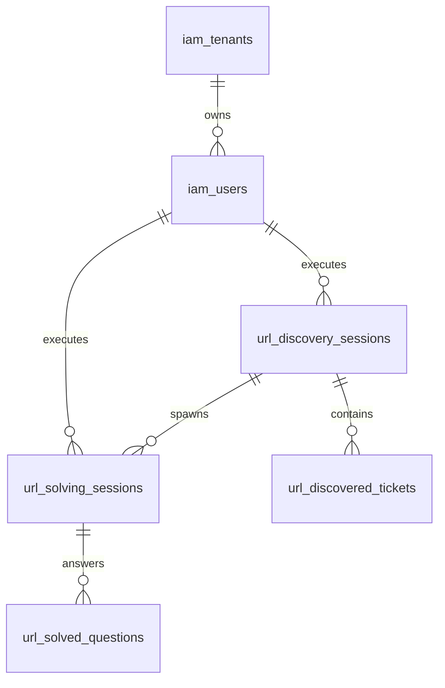

# AI Test Platform — Database Schema & Data Modeling

**Database Engine:** PostgreSQL 16.15  
**Connection Port:** `5433`  
**Database Name:** `ai_test_platform`  
**Migration Tool:** Flyway 10.x  

---

## 1. Migration History

| Version | Script Name | Description | Status |
|:---|:---|:---|:---|
| **V1** | `V1__init_platform_schema.sql` | Core IAM (tenants, users, credentials), audit logs, billing accounts. | APPLIED |
| **V2** | `V2__universal_web_testing_schema.sql` | Web projects, automated test plans, test runs, defect tracking. | APPLIED |
| **V3** | `V3__production_auth_and_exam_engine.sql` | Google OAuth, Telegram SSO link, practice sessions, exam questions. | APPLIED |
| **V4** | `V4__url_test_solving_engine.sql` | URL discovery sessions, discovered tickets, solving sessions, solved questions. | APPLIED |
| **V5** | `V5__adaptive_execution_and_browser_evidence.sql` | Adaptive execution modes, submission status, screenshot paths, evidence JSON. | APPLIED |

---

## 2. Core Entity-Relationship Diagram (ERD)

---

## 3. Key Table Schemas

### `url_discovery_sessions`
- `id` (UUID, PK)
- `tenant_id` (UUID, FK -> `iam_tenants.id`)
- `user_id` (UUID, FK -> `iam_users.id`)
- `target_url` (VARCHAR 1000)
- `platform_type` (VARCHAR 50) — e.g. `PRAVAONLINE_UZ`, `GENERIC_WEB`
- `discovered_title` (VARCHAR 500)
- `ticket_count` (INT)
- `confirmation_message` (TEXT)
- `created_at` (TIMESTAMPTZ)

### `url_discovered_tickets`
- `id` (UUID, PK)
- `discovery_session_id` (UUID, FK -> `url_discovery_sessions.id`)
- `ticket_number` (INT)
- `title` (VARCHAR 255) — e.g. `1-bilet`
- `ticket_url` (VARCHAR 1000)
- `question_count` (INT) — e.g. `10`
- `category` (VARCHAR 100)

### `url_solving_sessions`
- `id` (UUID, PK)
- `tenant_id` (UUID, FK -> `iam_tenants.id`)
- `user_id` (UUID, FK -> `iam_users.id`)
- `discovery_session_id` (UUID, FK -> `url_discovery_sessions.id`)
- `target_url` (VARCHAR 1000)
- `selected_ticket_numbers` (TEXT) — e.g. `"1"`, `"1-5"`, `"ALL"`
- `language` (VARCHAR 20) — e.g. `uz-Latn`
- `status` (VARCHAR 50) — `PENDING`, `SOLVING`, `COMPLETED`, `FAILED`
- `execution_mode` (VARCHAR 50) — `ANSWER_MODE`, `AUTHORIZED_AUTOMATION_MODE`, `GUIDED_MODE`
- `submissionStatus` (VARCHAR 50) — `NOT_STARTED`, `WAITING_FOR_APPROVAL`, `VERIFIED`, `FAILED`
- `screenshot_path` (TEXT) — Static relative path e.g. `artifacts/screenshots/ticket-1-evidence-...png`
- `execution_evidence_json` (TEXT)
- `browser_logs` (TEXT)
- `total_questions` (INT)
- `solved_questions_count` (INT)
- `verified_questions_count` (INT)
- `review_needed_count` (INT)
- `execution_time_ms` (BIGINT)
- `created_at` (TIMESTAMPTZ)
- `completed_at` (TIMESTAMPTZ)

### `url_solved_questions`
- `id` (UUID, PK)
- `solving_session_id` (UUID, FK -> `url_solving_sessions.id`)
- `ticket_number` (INT)
- `ticket_title` (VARCHAR 255)
- `question_index` (INT)
- `question_text` (TEXT)
- `options_json` (TEXT)
- `selected_answer_index` (INT)
- `selected_answer_text` (TEXT)
- `ai_confidence_score` (DOUBLE PRECISION)
- `verification_status` (VARCHAR 50) — `VERIFIED`, `NEEDS_REVIEW`, `AMBIGUOUS`
- `reasoning_explanation` (TEXT)
- `rule_reference` (VARCHAR 255) — e.g. `YHQ 13.11-band`
- `ambiguity_note` (TEXT)
