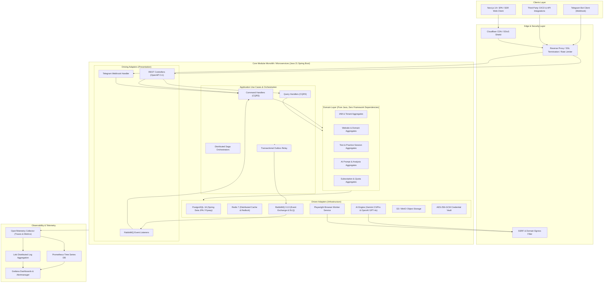
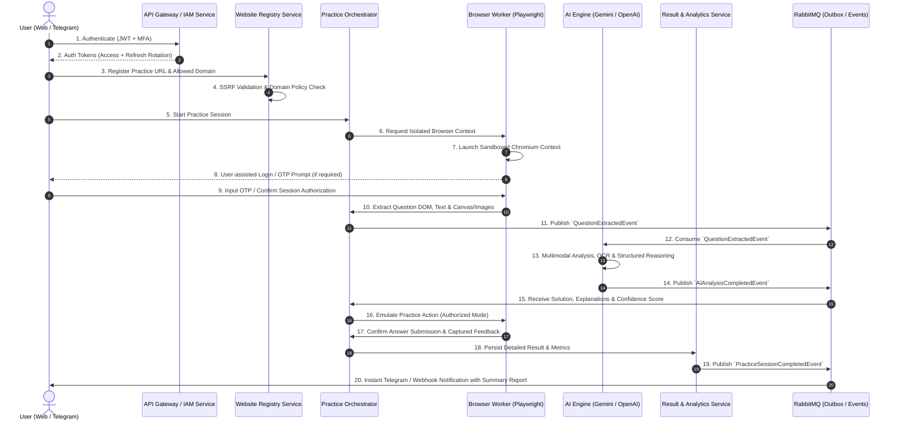

# Enterprise AI Test Automation Platform — Architecture Blueprint

## 1. Executive Summary & Vision

The **AI Test Automation Platform** is an enterprise-grade, multi-tenant SaaS engineered to empower learners, engineers, and educational institutions to practice, analyze, and automate interaction with test platforms ethically and securely.

The platform provides:
- Secure, authorized integration with user-registered testing and practice portals.
- AI-driven question comprehension, multi-modal OCR, reasoning, solution explanations, and difficulty scoring.
- Automated practice execution inside isolated, ephemeral Playwright browser sessions.
- Multi-channel interfaces: Modern Next.js Responsive Web Application and interactive Telegram Bot.
- Enterprise-grade resilience, telemetry, auditability, and bank-grade credential security (AES-256-GCM encryption, SSRF guards, strict domain allowlisting).

> [!IMPORTANT]
> **Ethical Boundary & Non-Circumvention Policy**:
> As mandated by engineering and legal specifications, this platform strictly forbids:
> 1. Automated impersonation during proctored/monitored high-stakes exams.
> 2. Bypassing anti-bot, captcha, or MFA protections without user explicit interaction.
> 3. Stealing or scraping unauthorized assessment pools.
> All browser interactions require explicit user authorization, and high-stakes/proctored exam platforms are blacklisted by default.

---

## 2. High-Level Architectural Topology

The system is structured as a **Modular Clean Architecture (Hexagonal / Ports & Adapters)**, built on Java 21 LTS and Spring Boot 3.3+. The design adheres strictly to Domain-Driven Design (DDD) bounded contexts, enabling zero-coupling modular deployment today and seamless extraction into standalone microservices when horizontal scale demands it.

---

## 3. Core Business Workflow & Dataflow

---

## 4. Key Architectural Decisions Summary

1. **Modular Monolith First, Microservices-Ready**:
   Packaged as clean decoupled modules with bounded domain contexts. Services communicate via strict Java API interfaces within JVM and asynchronous RabbitMQ domain events. Separation of database schemas guarantees zero shared-database coupling.
2. **Strict Hexagonal Ports and Adapters**:
   Domain business logic has 0 dependencies on Spring, Hibernate, or any third-party framework.
3. **Resilience & Fault Isolation**:
   Circuit breakers (Resilience4j), rate limiters, token bucket filters, and isolated worker pools prevent cascading failures.
4. **Zero-Trust Security**:
   AES-256-GCM encryption for all stored credentials, JWT with cryptographic key rotation, fine-grained RBAC/ABAC, and strict SSRF egress filters.
