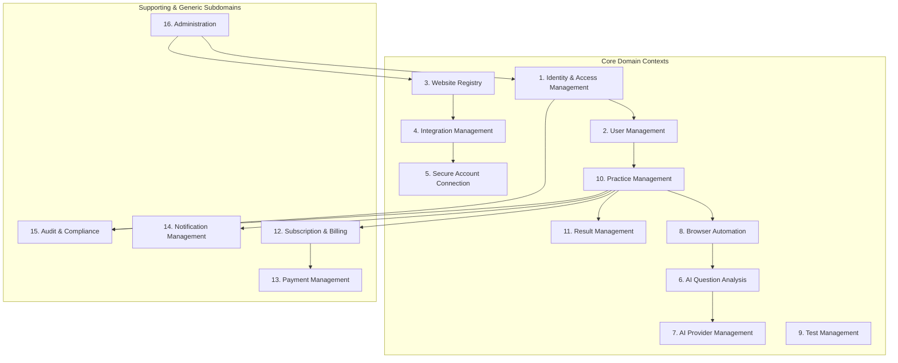

# Domain Discovery, Bounded Contexts & Ubiquitous Language

This document specifies the 16 Bounded Contexts of the **Enterprise AI Test Automation Platform**, defining their domain boundaries, aggregates, entities, value objects, domain events, and ubiquitous language.

---

## 1. Ubiquitous Language

- **Tenant**: An isolated customer account (organization or individual) with independent data, users, and quota limits.
- **User**: An authenticated actor within a tenant, holding one or more roles (ADMIN, INSTRUCTOR, LEARNER).
- **Registered Website**: An external practice or test portal URL validated through SSRF and domain governance rules.
- **Integration Profile**: Connection settings and credential identifiers for an external website, using OAuth2 or user-assisted sessions.
- **Practice Session**: An authorized interactive or automated practice run on an external testing platform.
- **Question**: A discrete assessment item extracted from a practice session, containing prompt text, options, question type, and optional media attachments.
- **AI Analysis**: The structured reasoning output generated by an AI provider, including the predicted answer, detailed explanation, confidence score, and taxonomy tags.
- **Browser Worker**: An isolated Chromium runner executing under ephemeral security boundaries to navigate and extract questions without circumventing proctoring protections.
- **Outbox Event**: A transactional domain event stored in the database and reliably relayed to the messaging broker.

---

## 2. The 16 Bounded Contexts

---

### Context 1: Identity & Access Management (IAM)
- **Responsibility**: Tenant registration, authentication, JWT issuing, refresh token rotation, MFA, RBAC/ABAC authorization.
- **Aggregate Root**: `Tenant`, `AccountCredential`.
- **Entities / Value Objects**: `UserId`, `TenantId`, `Role`, `Permission`, `HashedPassword`, `RefreshToken`, `MfaSecret`.
- **Domain Events**: `TenantCreatedEvent`, `UserAuthenticatedEvent`, `TokenRotatedEvent`, `AccountLockedEvent`.

### Context 2: User Management
- **Responsibility**: User profiles, preferences, role assignments, Telegram account linkage.
- **Aggregate Root**: `UserProfile`.
- **Entities / Value Objects**: `Email`, `PhoneNumber`, `TelegramChatId`, `UserStatus` (ACTIVE, SUSPENDED, PENDING_VERIFICATION).
- **Domain Events**: `UserProfileUpdatedEvent`, `TelegramAccountLinkedEvent`.

### Context 3: Website Registry
- **Responsibility**: Registry of supported/allowlisted testing platforms, URL parsing, SSRF verification, domain classification.
- **Aggregate Root**: `RegisteredWebsite`.
- **Entities / Value Objects**: `WebsiteId`, `DomainName`, `BaseUrl`, `PlatformType` (GENERIC_LMS, CUSTOM_PORTAL, CANVAS, MOODLE), `ComplianceStatus` (APPROVED, RESTRICTED, BLOCKED).
- **Domain Events**: `WebsiteRegisteredEvent`, `WebsiteBlockedEvent`.

### Context 4: Integration Management
- **Responsibility**: Tenant-specific integration configurations with external platforms.
- **Aggregate Root**: `TenantIntegration`.
- **Entities / Value Objects**: `IntegrationId`, `AuthType` (USER_ASSISTED, OAUTH2, API_KEY), `ConnectionStatus`.
- **Domain Events**: `IntegrationConfiguredEvent`, `IntegrationRevokedEvent`.

### Context 5: Secure Account Connection
- **Responsibility**: Encrypted credential storage (AES-256-GCM), ephemeral session tokens, user-controlled credentials vault.
- **Aggregate Root**: `SecureConnectionVault`.
- **Entities / Value Objects**: `EncryptedSecret`, `Iv`, `KeyVersion`, `ExpirationTimestamp`.
- **Domain Events**: `SecretStoredEvent`, `SecretRotatedEvent`, `SecretPurgedEvent`.

### Context 6: AI Question Analysis
- **Responsibility**: Ingestion of raw question DOM/images, multimodal OCR, question categorization, structured reasoning, confidence evaluation.
- **Aggregate Root**: `QuestionAnalysis`.
- **Entities / Value Objects**: `AnalysisId`, `QuestionContent`, `ExtractedOption`, `PredictedAnswer`, `Explanation`, `ConfidenceScore`, `TokenUsage`.
- **Domain Events**: `QuestionAnalysisRequestedEvent`, `QuestionAnalysisCompletedEvent`, `QuestionAnalysisFailedEvent`.

### Context 7: AI Provider Management
- **Responsibility**: Management of AI upstream providers (Google Gemini, OpenAI), fallback routing, rate limiting, token budget tracking.
- **Aggregate Root**: `AIProviderConfiguration`.
- **Entities / Value Objects**: `ProviderType` (GEMINI, OPENAI), `ModelIdentifier`, `CostPer1kTokens`, `RateLimitPolicy`.
- **Domain Events**: `ProviderSwitchedEvent`, `TokenBudgetExceededEvent`.

### Context 8: Browser Automation
- **Responsibility**: Playwright Chromium worker orchestration, isolated browser contexts, safe DOM extraction, viewport interaction without proctor bypass.
- **Aggregate Root**: `BrowserSession`.
- **Entities / Value Objects**: `SessionId`, `BrowserContextId`, `SessionStatus` (PROVISIONING, ACTIVE, EXTRACTING, TERMINATED), `ResourceConstraints`.
- **Domain Events**: `BrowserSessionStartedEvent`, `BrowserSessionTerminatedEvent`, `DOMExtractedEvent`.

### Context 9: Test Management
- **Responsibility**: Organization of test suites, categories, question banks, and learning objectives.
- **Aggregate Root**: `TestSuite`.
- **Entities / Value Objects**: `TestSuiteId`, `Category`, `TagList`, `DifficultyLevel`.
- **Domain Events**: `TestSuiteCreatedEvent`, `QuestionAddedToSuiteEvent`.

### Context 10: Practice Management
- **Responsibility**: Orchestration of live practice sessions, user interaction steps, question transitions, and session state machines.
- **Aggregate Root**: `PracticeSession`.
- **Entities / Value Objects**: `PracticeSessionId`, `SessionState` (INITIALIZED, AUTHENTICATING, IN_PROGRESS, PAUSED, COMPLETED, CANCELLED), `PracticeMode` (STUDY_ASSISTED, SELF_ASSESSMENT).
- **Domain Events**: `PracticeSessionStartedEvent`, `QuestionAnsweredEvent`, `PracticeSessionFinishedEvent`.

### Context 11: Result Management
- **Responsibility**: Persistence and calculation of test scores, answer analytics, performance trends, and exportable reports.
- **Aggregate Root**: `PracticeResult`.
- **Entities / Value Objects**: `ResultId`, `TotalScore`, `AccuracyRate`, `TimeSpentSeconds`, `DetailedQuestionReport`.
- **Domain Events**: `ResultGeneratedEvent`, `ReportExportedEvent`.

### Context 12: Subscription & Billing
- **Responsibility**: Tenant subscription tiers (FREE, PRO, ENTERPRISE), quotas (monthly AI tokens, concurrent browser sessions).
- **Aggregate Root**: `Subscription`.
- **Entities / Value Objects**: `SubscriptionId`, `PlanTier`, `RenewalDate`, `TokenQuota`, `SessionQuota`.
- **Domain Events**: `SubscriptionUpgradedEvent`, `QuotaExceededEvent`.

### Context 13: Payment Management
- **Responsibility**: Payment processing, invoice generation, checkout sessions.
- **Aggregate Root**: `Invoice`.
- **Entities / Value Objects**: `InvoiceId`, `Amount`, `Currency`, `PaymentProvider` (STRIPE, PAYME, CLICK), `PaymentStatus`.
- **Domain Events**: `PaymentSucceededEvent`, `PaymentFailedEvent`.

### Context 14: Notification Management
- **Responsibility**: Multi-channel delivery (Email, Webhook, Telegram Bot alerts) of practice results and security notices.
- **Aggregate Root**: `Notification`.
- **Entities / Value Objects**: `NotificationId`, `Channel` (EMAIL, TELEGRAM, IN_APP), `MessagePayload`, `DeliveryStatus`.
- **Domain Events**: `NotificationSentEvent`, `NotificationDeliveryFailedEvent`.

### Context 15: Audit & Compliance
- **Responsibility**: Immutable event logging, security trails, GDPR/FERPA compliance tracking, access auditing.
- **Aggregate Root**: `AuditRecord`.
- **Entities / Value Objects**: `AuditId`, `ActorId`, `ActionType`, `ResourceUri`, `ClientIp`, `Timestamp`.
- **Domain Events**: `SecurityAuditRecordedEvent`.

### Context 16: Administration
- **Responsibility**: System-wide configuration, tenant management, domain allowlist management, global feature flags.
- **Aggregate Root**: `SystemConfiguration`.
- **Entities / Value Objects**: `ConfigKey`, `ConfigValue`, `FeatureFlag`.
- **Domain Events**: `SystemConfigurationChangedEvent`.
