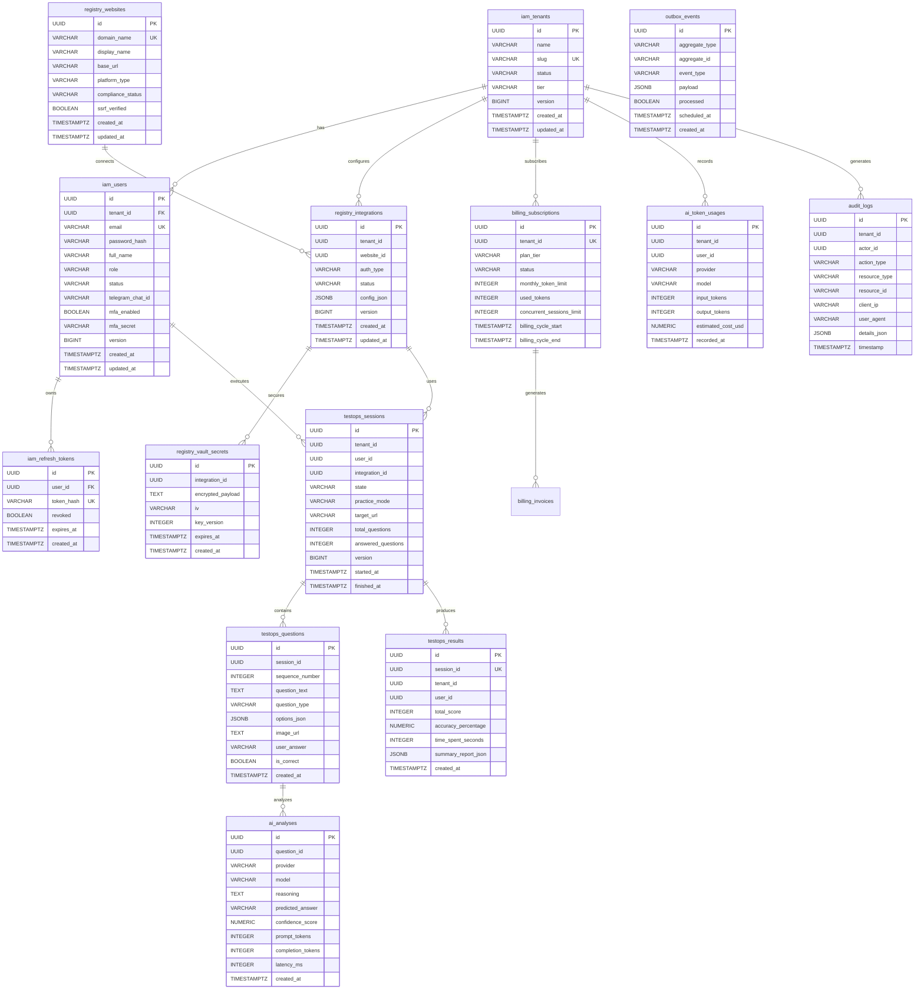

# Database Architecture & Entity-Relationship Model

## 1. Storage Strategy & Guidelines

1. **RDBMS**: PostgreSQL 16 LTS with UTF-8 encoding.
2. **Primary Keys**: UUID (`uuid_generate_v4()` or application-generated UUIDv7) for uniform distributed generation, security against enumeration attacks, and multi-tenant portability.
3. **Multi-Tenancy**: Logical tenant isolation via `tenant_id UUID NOT NULL` indexed across all tenant-scoped tables, reinforced with Hibernate multitenancy filters.
4. **Optimistic Locking**: Every mutable aggregate root contains a `version BIGINT NOT NULL DEFAULT 0` column.
5. **Auditing**: Standard columns `created_at TIMESTAMPTZ NOT NULL`, `updated_at TIMESTAMPTZ NOT NULL`, `created_by VARCHAR(100)`, and `updated_by VARCHAR(100)`.
6. **No Cross-Schema Hard Foreign Keys**: Tables belong to their respective Bounded Context schemas. Cross-context references are maintained by ID only to preserve microservice independence.

---

## 2. Entity-Relationship Diagram (Mermaid)

---

## 3. Database Indexes & Optimization Rules

1. `CREATE INDEX idx_users_tenant_email ON iam_users(tenant_id, email);`
2. `CREATE INDEX idx_refresh_tokens_hash ON iam_refresh_tokens(token_hash) WHERE revoked = false;`
3. `CREATE INDEX idx_sessions_tenant_user_state ON testops_sessions(tenant_id, user_id, state);`
4. `CREATE INDEX idx_questions_session ON testops_questions(session_id, sequence_number);`
5. `CREATE INDEX idx_analyses_question ON ai_analyses(question_id);`
6. `CREATE INDEX idx_audit_tenant_time ON audit_logs(tenant_id, timestamp DESC);`
7. `CREATE INDEX idx_outbox_unprocessed ON outbox_events(scheduled_at) WHERE processed = false;`
