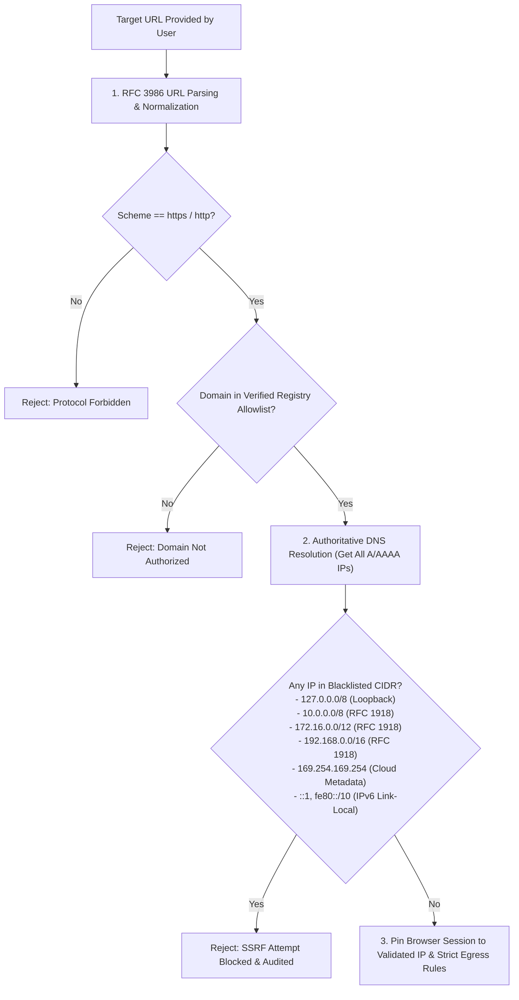

# Security Architecture, Threat Model (STRIDE) & OWASP Mitigation

## 1. Threat Modeling (STRIDE)

| Threat Category | Risk Description | Architectural Mitigation |
|---|---|---|
| **Spoofing** | Attacker impersonates legitimate tenant user or API client. | Stateless asymmetric/HMAC JWT with short expiry (15m); cryptographically hashed refresh tokens rotated upon single use; optional TOTP MFA; client IP/User-Agent fingerprint validation. |
| **Tampering** | Modification of test scores, questions, or AI results in flight. | Database optimistic locking (`version`); HMAC validation on webhook payloads; immutable audit logs; TLS 1.3 end-to-end encryption. |
| **Repudiation** | User denies initiating a browser practice session or modifying credentials. | Comprehensive `audit_logs` capturing `tenant_id`, `actor_id`, `action_type`, `client_ip`, and cryptographic hash of action parameters. |
| **Information Disclosure** | Leakage of decrypted target portal credentials or cross-tenant assessment data. | Multi-tenant query enforcement; AES-256-GCM credential vault with envelope encryption; automated redaction of sensitive fields (passwords, tokens, OTPs) from logs. |
| **Denial of Service** | Resource exhaustion via runaway browser automation workers or excessive AI tokens. | Token bucket rate limiting (Bucket4j); max concurrent session caps per tenant; timeout budgets (Playwright sessions killed after 15m inactivity); AI token spend hard limits. |
| **Elevation of Privilege** | Normal LEARNER user attempts to access tenant configuration or admin metrics. | Spring Security `@PreAuthorize` method security enforcing strict RBAC (`ROLE_TENANT_ADMIN`, `ROLE_INSTRUCTOR`, `ROLE_LEARNER`) and ABAC tenant ownership checks. |

---

## 2. Server-Side Request Forgery (SSRF) Defense Architecture

External URL validation is critical because users provide target URLs for browser practice.

### Implementation Specifics
1. **Network Egress Hardening**: Playwright workers run in containerized environments with strict iptables / egress network policies blocking access to internal Kubernetes CIDRs, VPC subnets, and AWS/GCP metadata endpoints (`169.254.169.254`).
2. **DNS Rebinding Guard**: The application resolves DNS synchronously and pins the socket connection directly to the verified remote IP.

---

## 3. Credential Protection & Ethical Execution Guardrails

1. **Vault Architecture**:
   - Secrets are encrypted with **AES-256-GCM** using a 256-bit Key Encryption Key (KEK) managed in HashiCorp Vault or AWS KMS / environment master key.
   - Every secret entry stores an initialization vector (IV, 96 bits) and authentication tag (128 bits). Plaintext secrets are never stored in log files or memory dumps.
2. **User-Controlled Interactive Sessions**:
   - For portals requiring multi-factor authentication (SMS/App OTP), the user is presented with a secure live browser stream or approval dialog.
   - The platform **never logs or persists OTP codes**.
3. **Strict Non-Circumvention Policy**:
   - Automated detection and hard blocking of proctored domains (`proctorio.com`, `respondus.com`, `honorlock.com`, `examity.com`, `proctoru.com`).
   - If an external website's robots.txt or terms explicitly prohibit automated practice, the domain is flagged as `COMPLIANCE_RESTRICTED`.

---

## 4. OWASP Top 10 Mitigation Matrix

| OWASP Risk | Platform Control |
|---|---|
| **A01: Broken Access Control** | Tenant isolation filter in Spring Security; automated IDOR checks in service layer verifying `resource.tenantId.equals(currentTenantId)`. |
| **A02: Cryptographic Failures** | BCrypt (work factor 12) for passwords; AES-256-GCM for secrets; TLS 1.3 strictly required in production; automated secret scanner in CI. |
| **A03: Injection** | Spring Data JPA parameterized SQL; Playwright CSS/XPath locators strictly sanitized; no `eval()` or unvalidated shell execution. |
| **A04: Insecure Design** | Threat modeling documented; rate limits per IP and per tenant; automated circuit breakers on third-party calls. |
| **A05: Security Misconfiguration** | OWASP Secure Headers (CSP, X-Content-Type-Options, Strict-Transport-Security, X-Frame-Options); unprivileged non-root Docker execution. |
| **A06: Vulnerable Components** | Automated Trivy container scanning and OWASP Dependency Check running in GitHub Actions CI. |
| **A07: Identification Failures** | Refresh token rotation; brute force protection (5 failed attempts locks user for 15 minutes); secure cookie flags (`HttpOnly`, `Secure`, `SameSite=Strict`). |
| **A08: Software & Data Integrity** | Cryptographic verification of build artifacts; transactional Outbox ensuring atomic event state. |
| **A09: Logging & Monitoring Failures** | Centralized structured JSON logging via OpenTelemetry & Loki; Grafana alerts triggered on spike in authentication failures or 5xx errors. |
| **A10: SSRF** | Comprehensive SSRF Guard validating URL schemes, hostnames, and resolved IPs against private/internal CIDR blocks. |
