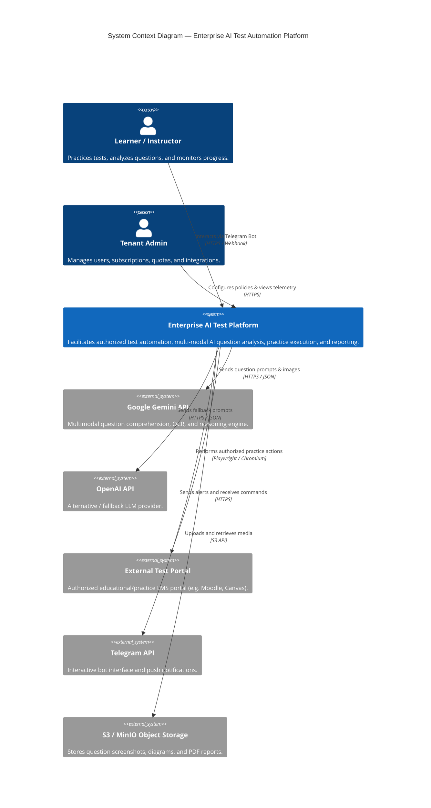

# C4 Architecture Models

## Level 1: System Context Diagram



---

## Level 2: Container Diagram

```mermaid
C4Container
    title Container Diagram — Enterprise AI Test Automation Platform

    Person(user, "User / Admin", "Learners, educators, administrators")

    Container(frontend, "Web Frontend", "Next.js 14, React, TypeScript, Tailwind", "Delivers responsive UI, practice dashboards, and real-time session feedback.")
    Container(tgBot, "Telegram Bot Handler", "Java Telegram Bot SDK", "Handles chat commands, interactive practice prompts, and push notifications.")

    Container_Boundary(backend_boundary, "Backend Core Services (Spring Boot 3.3 / Java 21)")
        Container(apiGateway, "API Gateway / Security", "Spring Security, Web, Actuator", "Authenticates requests, rate limits, routes to application use cases.")
        Container(appServices, "Application Core & Sagas", "Spring Boot Modular Hexagonal", "Coordinates practice sessions, SSRF verification, outbox event generation.")
        Container(aiEngine, "AI Inference Engine", "Spring WebClient / Virtual Threads", "Abstracts Gemini & OpenAI, manages prompts, tracks tokens.")
        Container(browserWorker, "Playwright Browser Worker", "Playwright Java, Headless Chromium", "Manages isolated browser contexts, navigates authorized portals.")
    Container_Boundary_End()

    ContainerDb(postgres, "PostgreSQL 16", "Relational Database", "Stores tenants, users, tests, questions, results, audit logs, and outbox events.")
    ContainerDb(redis, "Redis 7", "In-Memory Cache & Lock", "Handles rate limiting, distributed caching, session state, and deduplication keys.")
    Container(rabbitmq, "RabbitMQ 3.13", "Message Broker", "Asynchronous event queues, outbox worker distribution, and dead letter queues.")
    Container(minio, "MinIO / S3", "Object Storage", "Stores captured screenshots, PDFs, and assets.")

    Rel(user, frontend, "Visits", "HTTPS")
    Rel(user, tgBot, "Messages", "Telegram Protocol")
    Rel(frontend, apiGateway, "API Calls", "JSON / HTTPS")
    Rel(tgBot, appServices, "Invokes Use Cases", "Java In-Process / Event")

    Rel(apiGateway, appServices, "Dispatches Commands/Queries", "Virtual Threads")
    Rel(appServices, postgres, "Reads/Writes Entities", "HikariCP / JDBC")
    Rel(appServices, redis, "Caches & Locks", "Lettuce / Redis Protocol")
    Rel(appServices, rabbitmq, "Publishes/Consumes Events", "AMQP")
    Rel(appServices, aiEngine, "Requests AI Analysis", "In-Process Port")
    Rel(appServices, browserWorker, "Commands Browser Action", "In-Process / Worker Queue")
    Rel(browserWorker, minio, "Saves Screenshots", "S3 API")
```

---

## Level 3: Component Diagram (Core Application)

```mermaid
C4Component
    title Component Diagram — Practice & AI Execution Engine

    Container_Boundary(practice_boundary, "Practice Orchestration")
        Component(practiceController, "Practice REST Controller", "Spring Web", "Exposes /api/v1/practice endpoints.")
        Component(practiceService, "Practice Application Service", "Spring Service", "Orchestrates practice lifecycle state machine.")
        Component(ssrfGuard, "SSRF Guard & Domain Validator", "Java Component", "Validates target URLs against whitelist and CIDR blocks.")
        Component(browserAdapter, "Playwright Browser Adapter", "Playwright Port Implementation", "Spawns sandboxed Chromium contexts.")
        Component(aiRouter, "AI Model Router & Fallback", "AI Port Implementation", "Routes to Gemini with automated fallback to OpenAI.")
        Component(outboxService, "Transactional Outbox Service", "Spring Service", "Atomically persists domain events into outbox_events.")
        Component(practiceRepo, "Practice Session Repository", "Spring Data JPA Port", "Reads and writes session aggregate state.")
    Container_Boundary_End()

    Rel(practiceController, practiceService, "Calls startSession()")
    Rel(practiceService, ssrfGuard, "Validates targetUrl")
    Rel(practiceService, browserAdapter, "Requests question extraction")
    Rel(practiceService, aiRouter, "Requests answer analysis")
    Rel(practiceService, practiceRepo, "Saves aggregate state")
    Rel(practiceService, outboxService, "Registers DomainEvent")
```

---

## Level 4: Deployment Diagram (Production Kubernetes)

```mermaid
deployment
    title Kubernetes Production Deployment Topology

    Deployment_Node(cloud, "Cloud Provider (AWS / GCP / Bare Metal)", "Multi-AZ Cloud Infrastructure") {
        Deployment_Node(edge, "Edge & Security") {
            Infrastructure(ingress, "Nginx Ingress Controller", "SSL Termination, WAF, Rate Limiting")
        }

        Deployment_Node(k8s_cluster, "Production Kubernetes Cluster (v1.30+)") {
            Deployment_Node(namespace_app, "Namespace: ai-test-platform") {
                Deployment_Node(pod_app, "Backend Pods (HPA: 2 - 10 replicas)") {
                    Container(backend_container, "app-service", "Java 21 Distroless Container")
                }
                Deployment_Node(pod_worker, "Browser Worker Pods (HPA: 2 - 8 replicas)") {
                    Container(worker_container, "browser-worker", "Chromium + Playwright Java Container")
                }
                Deployment_Node(pod_frontend, "Frontend Pods (HPA: 2 - 6 replicas)") {
                    Container(frontend_container, "nextjs-ui", "Node.js 20 Alpine Standalone Container")
                }
            }

            Deployment_Node(namespace_infra, "Namespace: data-platform") {
                Deployment_Node(pg_cluster, "PostgreSQL HA Cluster") {
                    ContainerDb(pg_primary, "Postgres Primary", "Patroni / CloudNative-PG")
                    ContainerDb(pg_standby, "Postgres Standby", "Streaming Replication")
                }
                Deployment_Node(redis_cluster, "Redis Sentinel Cluster") {
                    ContainerDb(redis_master, "Redis Master", "In-Memory Cache")
                    ContainerDb(redis_replica, "Redis Replica", "High-Availability Failover")
                }
                Deployment_Node(rmq_cluster, "RabbitMQ Cluster") {
                    Container(rmq_nodes, "RabbitMQ Quorum Nodes", "Mirrored Queues")
                }
            }

            Deployment_Node(namespace_obs, "Namespace: observability") {
                Container(otel_col, "OpenTelemetry Collector", "Ingests traces, metrics, logs")
                Container(prom, "Prometheus", "Metrics storage & evaluation")
                Container(graf, "Grafana", "Dashboards & alerts")
                Container(loki_svc, "Loki", "Log aggregation")
            }
        }
    }

    Rel(ingress, frontend_container, "Routes / to Next.js", "HTTP")
    Rel(ingress, backend_container, "Routes /api to Spring Boot", "HTTP")
    Rel(backend_container, pg_primary, "Database Queries", "HikariCP")
    Rel(backend_container, redis_master, "Cache & Redlock", "RESP")
    Rel(backend_container, rmq_nodes, "Events & Tasks", "AMQP")
    Rel(worker_container, rmq_nodes, "Pulls Browser Jobs", "AMQP")
    Rel(backend_container, otel_col, "Exports OTLP Traces", "gRPC")
```
